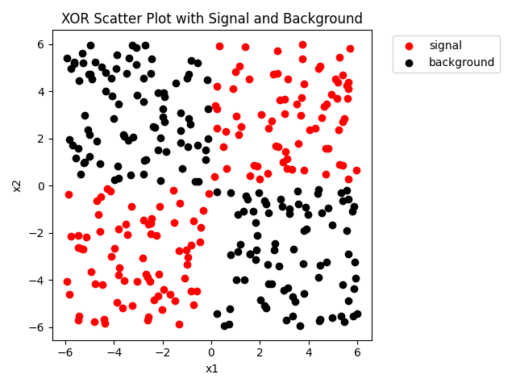
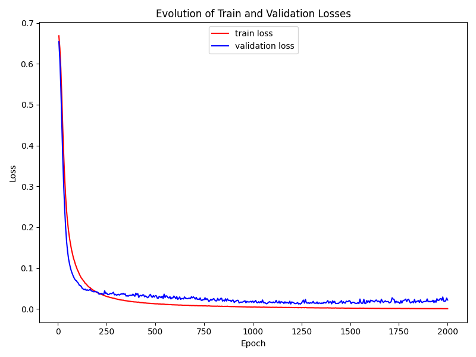
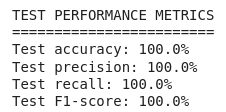
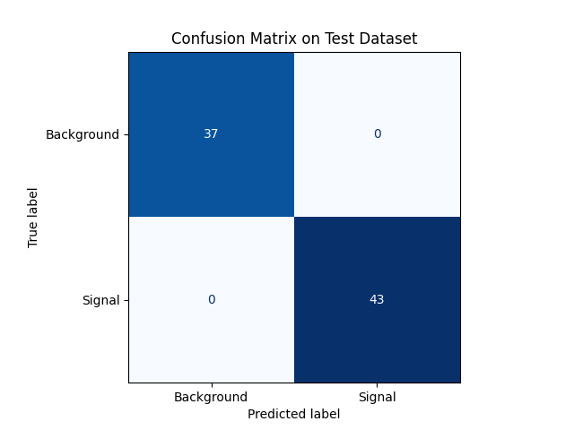
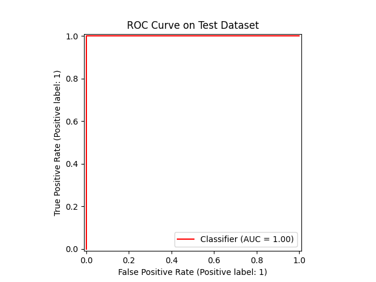
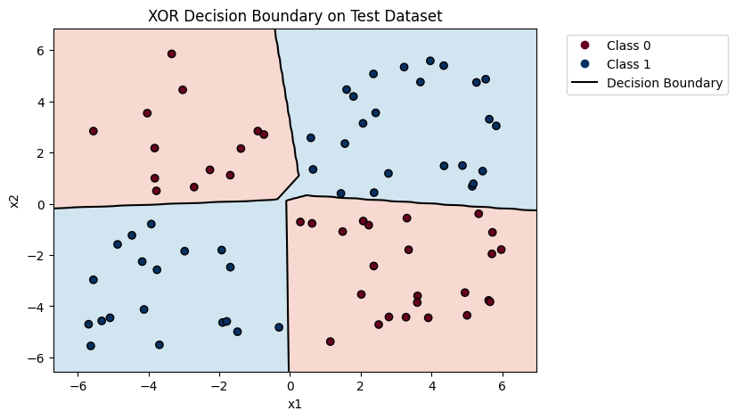

# Non-Linear XOR Classification with PyTorch

An end-to-end binary classification project implementing a multi-layer perceptron (MLP) in PyTorch to separate a two-dimensional XOR dataset. Because opposing quadrants in an XOR distribution are not linearly separable, a single linear boundary cannot classify the data. This repository walks through data exploration, leak-free feature scaling, neural network training, and held-out test evaluation with full visual diagnostics.

## Dataset & Problem Formulation

The dataset contains two continuous input features (`x1`, `x2`) and a binary target (`class`) split across `data/train.csv` and `data/test.csv` (80 test samples):

- **Signal (`1`):** Samples falling in Quadrants I and III (both coordinates share the same sign).
- **Background (`0`):** Samples falling in Quadrants II and IV (coordinates have opposite signs).



## Project Layout

```text
xor-function-neural-network/
├── data/
│   ├── train.csv                              # Training and validation dataset
│   └── test.csv                               # Held-out test dataset (80 rows)
├── model/
│   ├── neural_network.pth                     # Saved PyTorch state_dict weights
│   └── standard_scaler.joblib                 # Fitted StandardScaler parameters
├── notebooks/
│   ├── 01_model_training_and_tuning.ipynb     # Data prep, architecture, training loop, and export
│   └── 02_model_evaluation_and_metrics.ipynb  # Inference, test metrics, ROC curve, and decision boundary
├── plots/
│   ├── train_data_scatter_plot.png            # 2D scatter plot of training samples
│   ├── train_validation_loss_evolution.png    # Training vs. validation BCE loss curve
│   ├── confusion_matrix_on_test.png           # Test set confusion matrix
│   ├── roc_curve_on_test.png                  # Test set ROC curve
│   └── decision_boundary_on_test.png          # Learned non-linear decision surface
├── test-results/
│   └── test_metrics.png                       # Console summary of test evaluation metrics
├── requirements.txt                           # Pinned project dependencies
└── README.md
```

## Model Design & Training Workflow

All preprocessing and training logic is contained in `notebooks/01_model_training_and_tuning.ipynb`:

- **Leak-Free Scaling:** `StandardScaler` is fitted strictly on the training split and saved to `model/standard_scaler.joblib` so identical transformation statistics are applied during test inference.
- **Network Architecture:** Built with `nn.Sequential`:
  - `Linear(2 -> 4)` + `ReLU`
  - `Linear(4 -> 4)` + `ReLU`
  - `Linear(4 -> 1)` (outputs raw logits)
- **Loss & Reproducibility:** Trained using `nn.BCEWithLogitsLoss()` with `torch.manual_seed(42)`. Learned parameters are exported via `model.state_dict()` to `model/neural_network.pth`.



## Evaluation & Test Results

Final evaluation is isolated in `notebooks/02_model_evaluation_and_metrics.ipynb`. The notebook loads `data/test.csv`, applies `standard_scaler.joblib`, restores `neural_network.pth`, converts output logits to probabilities with `torch.sigmoid`, and classifies samples at a `0.5` decision threshold.



| Metric | Score |
| :--- | :---: |
| **Accuracy** | 100.0% |
| **Precision** | 100.0% |
| **Recall** | 100.0% |
| **F1-Score** | 100.0% |

### Confusion Matrix & ROC Curve

The network classifies all 80 unseen test samples without false positives or false negatives.

| Confusion Matrix | ROC Curve |
| :---: | :---: |
|  |  |

### Decision Boundary

Evaluating the trained model over a 2D meshgrid across the input domain shows how the two ReLU hidden layers partition the four XOR quadrants cleanly:



## Running Locally

1. **Clone the repository:**
   ```bash
   git clone https://github.com/nfor-ojong/xor-function-neural-network.git
   cd xor-function-neural-network
   ```

2. **Install dependencies:**
   ```bash
   pip install -r requirements.txt
   ```

3. **Open the notebooks:**
   Launch Jupyter or VS Code and run `notebooks/01_model_training_and_tuning.ipynb` followed by `notebooks/02_model_evaluation_and_metrics.ipynb`.
